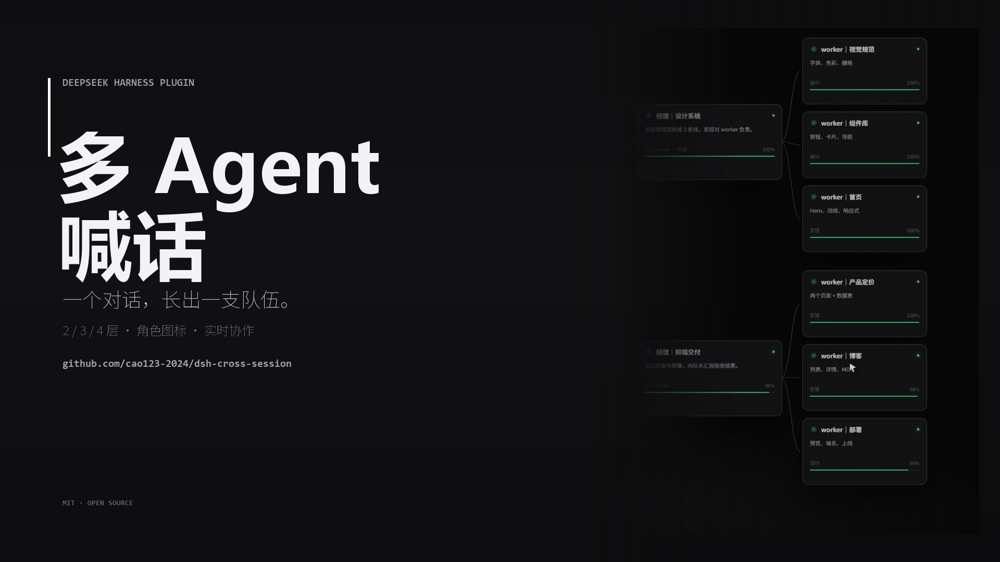

# DSH 多 Agent 喊话（dsh-cross-session）

> 让 DeepSeek Harness 里的多个对话像一支队伍一样协作：队长开新对话、分派任务、运行中插话、只读查看进度；worker 有问题直接回问队长。



预告片（1080p / 48s，无旁白 · 真实 DSH 界面 · 鼠标跟随 3D）：[下载 MP4](https://github.com/cao123-2024/dsh-cross-session/releases/download/v1.2.0/dsh-cross-session-film.mp4)

这是一个 **DeepSeek Harness（DSH）持久化插件**，不依赖任何第三方包，直接以本地目录安装。

```
队长对话 ── new_conversation ──▶ worker 对话 A
    │  ◀──── shout / ask_master ────┘
    │
    └────── get_chat_info（只读看上下文与进度）
```

## 它和官方 Super Agent 的区别

### (a) 我们超过 Super Agent 的地方

| 维度 | 多 Agent 喊话 | 官方 Super Agent |
| --- | --- | --- |
| 对话可见 | 每个 Agent 都是侧边栏里的独立对话，能点开、插话、改名、归档 | 工单 / 会话在它自己的体系里，桌面侧栏看不到 |
| 实时协作 | 运行中在 step 边界插话，空闲时唤醒 | 通常等任务结束或人工审批 |
| 队员回问队长 | worker 用 `ask_master` 直接回问创建它的队长 | 没有桌面会话通道 |
| 只读看进度 | `get_chat_info` 看 turn、step、最近工具调用 | 只能看工单状态 / PR |
| 层级可视化 | 队长 / 总监 / 经理 / worker 角色图标，2 / 3 / 4 层自由组合 | 单层自主工人 |

### (b) Super Agent 做得比我们好的地方

| 维度 | 官方 Super Agent | 我们 |
| --- | --- | --- |
| 仓库自主 | 监听 GitHub issue、评论、飞书，自动接单、开 worktree、开 PR | 不做仓库接单 |
| 云端常驻 | 跑在云端，不依赖你的电脑开着 | 依赖本地 DSH 进程在跑 |
| 离线与重启 | 工单在服务端持久，重启不丢待办 | 重启后 pending inbox 不会自唤醒 |
| 组织与审计 | 平台级权限、审计、多人协作 | 沿用 DSH 权限预设，没有组织审计 |
| 长任务托管 | 可连续数天无人值守 | 更适合桌面上的即时协作 |

### (c) 支持情况

| 能力 | 多 Agent 喊话 | 官方 Super Agent |
| --- | --- | --- |
| 独立对话创建 / 命名 | ✓ | △ 工单 |
| 跨对话喊话 / 运行中插话 | ✓ | ✗ |
| worker 回问队长 | ✓ | ✗ |
| 只读查看对话上下文 | ✓ | △ 日志 |
| 2 / 3 / 4 层团队 | ✓ | ✗ |
| GitHub issue → PR | ✗ | ✓ |
| 云端 / 离线运行 | ✗ | ✓ |
| 组织权限 / 审计 | ✗ | ✓ |
| 权限 / 模型 / 思考强度 | ✓ | △ |
| 自带 AI skill / 任务书 | ✓ | ✗ |

一句话：**Super Agent 管仓库，多 Agent 喊话管桌面；不是替代，是叠加。**

## 团队层级（2 / 3 / 4 层）

标题前缀就是角色，侧边栏会在名字前画图标：

> 新建对话自动带前缀；已有对话用 `assign_agent_role` 补角色。刷新页面后客户端图标生效。

| 角色 | 标题前缀 | 图标 | 职责 |
| --- | --- | --- | --- |
| 队长 leader | `队长｜` | 金色皇冠 | 接需求、拆分、派活、汇总 |
| 总监 director | `总监｜` | 紫色层叠 | 仅四层模式；管经理 |
| 经理 manager | `经理｜` | 青色菱形 | 管 3+ worker |
| worker | `worker｜` | 绿色齿轮 | 执行；问题回问上级 |

- **2 层**：队长直管 3–4 个 worker，默认。
- **3 层**：队长 → 经理 → worker；每个经理建议带 ≥3 个 worker。只能开 2 个经理时，不要硬开 3 层，回 2 层。
- **4 层**：队长 → 总监 → 经理 → worker；仅在 `allowFourTier: true` 且任务足够大时启用。

任务书只是建议：AI 可以自行决定经理数量、难度和层级，也可以不按任务书来。完整规则见 [docs/HIERARCHY.md](docs/HIERARCHY.md)，AI skill 见 [skills/multi-agent-shout/SKILL.md](skills/multi-agent-shout/SKILL.md)。

## 功能

| 工具 | 作用 |
| --- | --- |
| `new_conversation` | 新建独立对话，支持 `role` / `reports_to`；自动写角色标题前缀 |
| `assign_agent_role` | 给已有对话改角色（队长 / 总监 / 经理 / worker） |
| `get_agent_team` | 读当前层级、`allow_four_tier` 和每个 agent 的角色 |
| `list_conversations` | 列出 root 对话：标题、工作区、运行状态（已归档不显示） |
| `shout` | 向另一个对话投递消息：运行中在最近 step 边界收到，空闲时唤醒新 turn |
| `ask_master` | worker 专用：把问题/阻塞直接交给创建它的主 Agent，而不是问用户 |
| `get_chat_info` | 只读查看对话状态、当前 turn/step、最近消息与工具调用；目标完全无感知 |
| `rename_conversation` | 实时改侧边栏显示名（保留角色前缀） |
| `interrupt_conversation` | 停止目标当前 turn，保留待处理输入 |
| `archive_conversation` | 归档已完成的 worker |
| `list_permission_presets` / `list_models` | 查看可选权限预设与模型 |
| `configure_conversation` | 调整目标对话的权限预设 / 模型 / 思考强度 |

### 设计细节

- **投递**：`sessionController.resolveAgent(id)` 拿到 live Agent（冷会话自动 resume），再 `agent.steer(createUserMessage({ source: { kind: "agent-message", form: "relay", ... } }))`。
- **来源可读**：relay 的 `senderSessionId` 写成 `AI「发送者标题」`，UI 显示「来自会话 AI「标题」」；真实 id 保存在 `senderSessionIdReal`。
- **主 Agent 专属上下文**：`get_chat_info` 只注册在非 worker 的 Agent scope；worker 的工具列表里没有它。
- **权限继承**：`new_conversation` 默认把队长的权限预设复制给新对话。
- **安全护栏**：创建上限、每分钟限流、消息体积上限、同一对会话交替喊话上限（防 AI 乒乓）、拒绝 subagent 会话。

## 安装

要求：DSH `0.2.1-rc.x` 或 `0.3.x`（desktop 或其他 profile 均可），无额外依赖。

### 方式一：Plugin Manager（推荐）

在 DSH 中把仓库目录作为本地 bundle 安装，例如：

```text
plugin_manager install_bundle
target = <本仓库绝对路径>
```

### 方式二：CLI

```bash
dsh plugin --profile desktop add "<本仓库绝对路径>"
```

安装后在 profile 的 bundle 列表中启用 `@local/dsh-cross-session`，必要时刷新页面。

## 配置

`cordis.patch.yml`：

```yaml
- insert:
    - id: cross-session-shout
      name: '@local/dsh-cross-session'
      config:
        maxCreatedConversations: 12
        rateLimitPerMinute: 20
        maxMessageBytes: 32768
        maxShoutChain: 6
        inheritPermissions: true
        allowFourTier: false
```

## 已知限制

- `agent-message` 不会触发自动标题/活跃度，插件会显式 rename。
- 进程重启后 pending inbox 不会自唤醒；没有跨重启的离线投递通道。
- 喊话目标只支持 root 会话；subagent 会话会被拒绝。
- DSH 在创建时绑定对话工作区，已有对话不能原地迁移；`adopt_workspace` 会改为在新工作区创建项目对话。

## 许可证

MIT


